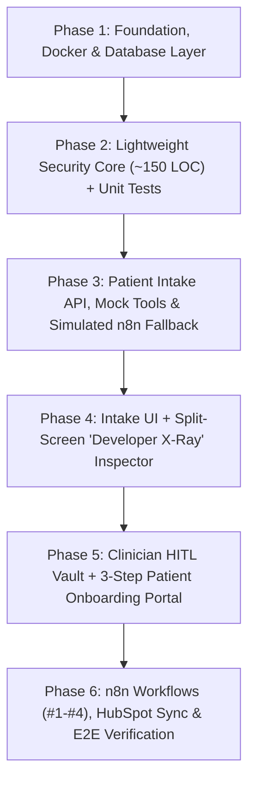

# AegisFlow Step-by-Step Implementation Plan

This implementation plan breaks down [PRD.md](file:///D:/vscode/Personal/AegisFlow/PRD.md), [GLOSSARY.md](file:///D:/vscode/Personal/AegisFlow/GLOSSARY.md), and [ADR-001](file:///D:/vscode/Personal/AegisFlow/docs/adr/001-zero-phi-hubspot-pseudonymization.md) through [ADR-007](file:///D:/vscode/Personal/AegisFlow/docs/adr/007-two-layer-idempotency-and-burned-tokens.md) into 6 sequential vertical slices. Each phase ends with a testable verification gate.

---

## Phase 1: Foundation, Docker & Database Layer

Set up the Next.js 15 application, local infrastructure containers, and PostgreSQL schema with append-only audit immutability.

1. **Initialize Next.js & Tooling**
   - Scaffold Next.js 15 (App Router, TypeScript, Tailwind CSS, `src/` directory).
   - Install core dependencies: `prisma`, `@prisma/client`, `zod`, `jose` (for edge-compatible RBAC JWTs), `lucide-react`, and `vitest` (for unit/integration tests).
2. **Docker Compose & Environment Configuration**
   - Create `docker-compose.yml` running:
     - `postgres:16-alpine` (Port `5432`, database `aegis`).
     - `n8nio/n8n:latest` (Port `5678`, configured with `EXECUTIONS_DATA_SAVE_ON_SUCCESS=none`, `EXECUTIONS_DATA_SAVE_ON_ERROR=all`, `EXECUTIONS_DATA_PRUNE=true`).
   - Create `.env.example` documenting all required keys (`DATABASE_URL`, `PHI_ENCRYPTION_KEY`, `AEGIS_WEBHOOK_SECRET`, `AEGIS_TOOL_API_KEY`, `JWT_RBAC_SECRET`, `DEMO_SIMULATE_N8N_IF_SLEEPING`).
3. **Database Schema & Immutability Trigger (`prisma/`)**
   - Define `prisma/schema.prisma` with the 4 core models from [PRD.md](file:///D:/vscode/Personal/AegisFlow/PRD.md#L222-L229):
     - `PatientVault` (UUID PK, `emailHash`, `encryptedPiiJson`, `encryptedSymptoms`, `encryptedKycJson`, `scrubbedSymptoms`, `aiTriageJson`, `onboardingTokenHash`, `tokenExpiresAt`, `tokenUsedAt`, `appointmentSlot`, `status`, `hubspotContactId`, `hubspotDealId`).
     - `ConsentRecord` (HIPAA intake, TCPA SMS, Telehealth NPP e-signatures).
     - `AuditLog` (Append-only log of actor, role, action, patientId, metadata, IP).
     - `WebhookIdempotency` (Unique key per workflow submission stage).
   - Create a custom SQL migration adding the `prevent_audit_log_modification()` PostgreSQL trigger that blocks `UPDATE` and `DELETE` on `"AuditLog"`.

> [!IMPORTANT]
> **Phase 1 Verification Gate:** `docker compose up -d` starts Postgres and n8n cleanly; `npx prisma migrate dev` applies the schema and immutability trigger.

---

## Phase 2: Lightweight Security Core (~150 LOC) & Unit Tests

Build the pure, zero-dependency security modules in `src/lib/` before wiring any UI or routes.

1. **`src/lib/crypto.ts` — Envelope Encryption & Hashing**
   - `encryptPhi(plaintext: string): string` and `decryptPhi(payload: string): string` using Node `crypto` (`aes-256-gcm`, 12-byte IV, 16-byte auth tag) formatted as `v1:{iv_hex}:{authTag_hex}:{ciphertext_hex}`.
   - `sha256Hash(input: string): string` for deterministic `emailHash`, `idempotency_key`, and `onboardingTokenHash` ([ADR-007](file:///D:/vscode/Personal/AegisFlow/docs/adr/007-two-layer-idempotency-and-burned-tokens.md)).
   - `generatePseudonymousAlias(uuid: string)` returning `{ firstName: "Patient_<short_uuid>", email: "<short_uuid>@vault.aegisflow.internal" }` ([ADR-001](file:///D:/vscode/Personal/AegisFlow/docs/adr/001-zero-phi-hubspot-pseudonymization.md)).
2. **`src/lib/hmac.ts` — Replay-Protected Webhook Signing**
   - `signWebhookPayload(rawBody: string, timestamp?: number)` producing `x-aegis-signature` and `x-aegis-timestamp`.
   - `verifyWebhookSignature(rawBody: string, signature: string, timestampHeader: string)` using `crypto.timingSafeEqual` and enforcing a `±300s` replay window.
3. **`src/lib/scrubber.ts` — Contextual + 6-Pass Regex PII Scrubber**
   - Implement `scrubSymptoms(rawText: string, knownEntities: KnownEntities)` per [ADR-002](file:///D:/vscode/Personal/AegisFlow/docs/adr/002-contextual-known-entity-scrubber.md):
     - **Pass 0:** Case-insensitive boundary replacement of known `firstName`, `lastName`, `email`, `phone`, and `memberId`.
     - **Passes 1–6:** Honorifics/self-identifiers, SSNs, US/Intl phones, emails, dates/DOBs, street addresses, and member ID patterns.
   - Return both `scrubbedText` and a list of `redactedSpans` (so the X-Ray UI can highlight detected PII in red).
4. **`src/lib/auth.ts` & `src/lib/audit.ts` — Clinician RBAC & Audit Service**
   - `mintDemoClinicianToken()` and `verifyClinicianSession()` using `jose` (`sub: "dr_chen_demo"`, `role: "CLINICIAN"`, 1-hour expiry) per [ADR-006](file:///D:/vscode/Personal/AegisFlow/docs/adr/006-frictionless-demo-rbac-session.md).
   - `logAudit(...)` helper writing append-only records to `prisma.auditLog`.

> [!IMPORTANT]
> **Phase 2 Verification Gate (Gates 1–3):** Run `npm test` (Vitest) to verify:
> - 25 synthetic clinical paragraphs with PII achieve `0%` raw PII survival.
> - 1-byte ciphertext tampering throws an GCM auth tag error, and expired/bad HMAC signatures fail verification.
> - Attempting `prisma.auditLog.delete()` or `.update()` throws the PostgreSQL HIPAA immutability exception.

---

## Phase 3: Backend API Routes, Mock Tools & Simulated n8n Fallback

Build the asynchronous event-driven API layer in `src/app/api/` so the entire 5-stage state machine works both with live n8n and with the cold-start simulator ([ADR-007](file:///D:/vscode/Personal/AegisFlow/docs/adr/007-two-layer-idempotency-and-burned-tokens.md)).

1. **Intake & Telemetry Endpoints**
   - `POST /api/intake`: Validates with Zod $\rightarrow$ checks `WebhookIdempotency` $\rightarrow$ writes `ConsentRecord` + encrypted `PatientVault` + `AuditLog` (`INTAKE_SUBMITTED`, `PII_SCRUBBED`) $\rightarrow$ dispatches async signed webhook to n8n #1 ([ADR-003](file:///D:/vscode/Personal/AegisFlow/docs/adr/003-async-webhook-callback-polling.md)). If n8n is unreachable and `DEMO_SIMULATE_N8N_IF_SLEEPING=true`, runs the built-in simulator; otherwise sets `WEBHOOK_RETRY_PENDING` ([ADR-004](file:///D:/vscode/Personal/AegisFlow/docs/adr/004-outbox-and-dlq-failure-recovery.md)). Returns `202 Accepted` immediately.
   - `GET /api/intake/[id]/telemetry`: Returns the 4-stage X-Ray snapshot (redacted spans, encrypted DB state, audit logs, outbound webhook payload, and AI/CRM callback status).
   - `POST /api/intake/[id]/retry`: Re-dispatches failed webhooks from the outbox state.
2. **n8n AI Agent Tool Endpoints & Callback**
   - `GET /api/mock/insurance`: Verifies `x-aegis-tool-key` and returns payer coverage + copay estimate for `Aetna_PPO`, `BlueCross_BlueShield`, `UnitedHealthcare`, etc.
   - `GET /api/mock/routing-rules`: Returns clinical specialty routing rules and emergency red-flag criteria.
   - `POST /api/webhooks/n8n-callback`: Verifies `x-aegis-signature`, validates AI triage JSON via Zod ([ADR-005](file:///D:/vscode/Personal/AegisFlow/docs/adr/005-xml-sandboxed-prompt-and-critical-short-circuit.md)), handles `CRITICAL` emergency short-circuits or `error-dlq` failures (`TRIAGE_FAILED_MANUAL_REVIEW`), and updates `PatientVault` + `AuditLog`.
3. **Clinician Approval, Blind Notify & Onboarding Completion Endpoints**
   - `POST /api/auth/demo-session`: Mints the 1-click `dr_chen_demo` JWT cookie ([ADR-006](file:///D:/vscode/Personal/AegisFlow/docs/adr/006-frictionless-demo-rbac-session.md)).
   - `POST /api/vault/[id]/approve`: Verifies Clinician JWT, generates 32-byte raw onboarding token, stores `onboardingTokenHash = sha256(token)` (`+48h` expiry), and triggers n8n Workflow #2.
   - `POST /api/internal/notify`: Verifies HMAC signature from n8n #2, decrypts patient email/phone in memory, and dispatches the magic link (`/onboarding/[token]`) via Resend (or logs to telemetry in demo mode) ([ADR-001](file:///D:/vscode/Personal/AegisFlow/docs/adr/001-zero-phi-hubspot-pseudonymization.md)).
   - `POST /api/onboarding/[token]/complete`: Verifies single-use token, saves encrypted KYC metadata + Telehealth NPP e-signature + appointment slot, burns token (`tokenUsedAt = now()`), and triggers n8n Workflow #3 ([ADR-007](file:///D:/vscode/Personal/AegisFlow/docs/adr/007-two-layer-idempotency-and-burned-tokens.md)).

---

## Phase 4: Patient Intake UI & Split-Screen "Developer X-Ray" Inspector

Build the main portfolio showcase page (`/intake` and `/`) where users and technical interviewers can test the pipeline and watch the 4 telemetry panels update live.

1. **Patient Intake Portal (`src/app/intake/page.tsx`)**
   - Clean clinical form capturing Demographics, Insurance Payer & Member ID, Free-Text Symptoms (with quick **"Fill Sample Patient"** preset buttons: *Routine Dermatology*, *High-Urgency Cardiology*, *Critical Emergency Short-Circuit*, and *Prompt Injection Attempt*), and HIPAA + TCPA consent checkboxes.
   - Emergency `911 / Emergency Care` short-circuit advisory banner when `status === "EMERGENCY_HALTED"` ([ADR-005](file:///D:/vscode/Personal/AegisFlow/docs/adr/005-xml-sandboxed-prompt-and-critical-short-circuit.md)).
2. **4-Panel Split-Screen "Developer X-Ray" Inspector**
   - Polls `GET /api/intake/[id]/telemetry` every `1,000ms` while active:
     - **Panel 1 (Raw Browser Payload & Redaction Diff):** Highlights detected PII entities in red alongside their `[REDACTED_*]` replacements.
     - **Panel 2 (PostgreSQL Vault & Immutable Audit Stream):** Shows the live `v1:iv:authTag:ciphertext` values and append-only `AuditLog` entries.
     - **Panel 3 (Stateless n8n Webhook & HMAC Inspector):** Displays the pseudonymous CRM alias (`Patient_<short_uuid>`), `x-aegis-signature`, and Outbox retry controls.
     - **Panel 4 (AI Triage Output & HubSpot Pipeline Card):** Shows the structured triage JSON, HubSpot Deal status, and a 1-click **"Review in Clinician Vault (Sign in as Dr. Sarah Chen)"** button.

---

## Phase 5: Clinician HITL Vault & 3-Step Patient Onboarding Portal

Complete the remaining two frontend surfaces to close the loop from `Pending Review` to `Closed Won`.

1. **Clinician HITL Vault (`src/app/admin/vault/[id]/page.tsx`)**
   - Enforces Clinician RBAC session; if unauthenticated, shows a security gate with the 1-click **"Sign in as Demo Clinician (Dr. Sarah Chen — Cardiology)"** button ([ADR-006](file:///D:/vscode/Personal/AegisFlow/docs/adr/006-frictionless-demo-rbac-session.md)).
   - Displays a prominent **"HIPAA Audit Logged: `PHI_DECRYPTED_VIEW` recorded for `dr_chen_demo`"** banner.
   - Renders decrypted patient demographics, raw vs. scrubbed clinical notes, AI Triage rationale, copay estimate, and the **"Approve & Dispatch Onboarding Magic Link"** button (which reveals the generated `/onboarding/[token]` link immediately for testing).
2. **3-Step Patient Onboarding Portal (`src/app/onboarding/[token]/page.tsx`)**
   - Validates the capability token hash. If already used (`tokenUsedAt !== null`), renders the read-only **"Onboarding Completed — Appointment Confirmed (Token Burned)"** receipt ([ADR-007](file:///D:/vscode/Personal/AegisFlow/docs/adr/007-two-layer-idempotency-and-burned-tokens.md)).
   - **Step 1 (KYC Verification):** Photo ID & Insurance Card confirmation with a 1-click *"Use Demo Insurance Card"* button.
   - **Step 2 (Telehealth Informed Consent & NPP):** Legal e-signature input box.
   - **Step 3 (Specialist Slot Picker):** Displays available slots for the approved specialty and submits to `POST /api/onboarding/[token]/complete`.

---

## Phase 6: Git-Tracked n8n Workflows, HubSpot Setup & E2E Verification

Create the declarative n8n workflow JSON files in `/n8n/workflows/` and run the full end-to-end verification suite.

1. **Declarative n8n Workflow JSON Exports (`n8n/workflows/`)**
   - `triage-agent.json` (Workflow #1: Webhook $\rightarrow$ HMAC Verify Code Node $\rightarrow$ XML-Sandboxed AI Agent + Insurance & Routing HTTP Tools $\rightarrow$ Emergency `CRITICAL` Switch $\rightarrow$ HubSpot Pseudonymous Contact & Deal Upsert $\rightarrow$ Next.js Callback).
   - `onboarding-dispatch.json` (Workflow #2: Webhook $\rightarrow$ HMAC Verify $\rightarrow$ HubSpot Deal Stage `Approved - Onboarding Sent` $\rightarrow$ Signed POST to Next.js `/api/internal/notify`).
   - `onboarding-complete.json` (Workflow #3: Webhook $\rightarrow$ HMAC Verify $\rightarrow$ HubSpot Deal `Closed Won` + Contact `customer` $\rightarrow$ Slack/Discord Clinic Alert).
   - `error-dlq.json` (Workflow #4: Global `Error Trigger` $\rightarrow$ Sanitize Payload $\rightarrow$ Slack Ops Alert $\rightarrow$ Signed POST to Next.js `/api/webhooks/n8n-callback` with `status: "TRIAGE_FAILED_MANUAL_REVIEW"`).
2. **End-to-End Test & Portfolio README (`Gate 4`)**
   - Run automated E2E tests covering the full 5-stage closed loop, prompt-injection defense, emergency short-circuit, and single-use token burn.
   - Write `README.md` with architecture diagrams, setup instructions, and links to `PRD.md`, `GLOSSARY.md`, and `docs/adr/`.
