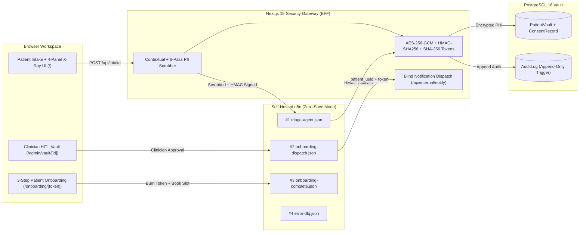

# AegisFlow — HIPAA-Compliant AI Patient Intake, Triage & HubSpot Onboarding Engine

**AegisFlow** is a full-stack healthcare security gateway and stateless workflow orchestration engine combining **Next.js 15 (App Router BFF)**, **PostgreSQL 16 (`AES-256-GCM` PHI Vault + Append-Only Audit Triggers)**, **Self-Hosted n8n (Zero-Data-Retention AI Agent Workflows)**, and **HubSpot CRM (Pseudonymous Deal & Contact Pipeline)**.

---

## Architecture Highlights & Locked ADRs

1. **Zero-PHI Outside the Vault ([ADR-001](file:///D:/vscode/Personal/AegisFlow/docs/adr/001-zero-phi-hubspot-pseudonymization.md)):**
   - Raw patient identity (`firstName`, `lastName`, `email`, `phone`, `dob`, `memberId`) and clinical symptom narratives (`rawSymptoms`) are encrypted at the application layer with `AES-256-GCM` (`v1:iv:authTag:ciphertext`) before reaching PostgreSQL.
   - n8n and HubSpot CRM never receive plaintext PII/PHI. HubSpot Contacts and Deals use deterministic pseudonymous aliases (`Patient_<short_uuid>`, `<short_uuid>@vault.aegisflow.internal`), and patient notifications use **Blind Notification Dispatch** (`POST /api/internal/notify`).
2. **Contextual + 6-Pass Regex PII Scrubber ([ADR-002](file:///D:/vscode/Personal/AegisFlow/docs/adr/002-contextual-known-entity-scrubber.md)):**
   - Scrubs dynamic patient names, emails, phones, and member IDs submitted in the intake form alongside 6 deterministic regex passes (`SSN`, `MRN`, `DOB`, `Email`, `Phone`, `MemberID`) before wrapping text inside `<untrusted_symptom_text>` XML tags.
3. **Async Webhook Dispatch (`202 Accepted`) & Outbox/DLQ Recovery ([ADR-003](file:///D:/vscode/Personal/AegisFlow/docs/adr/003-async-webhook-callback-polling.md), [ADR-004](file:///D:/vscode/Personal/AegisFlow/docs/adr/004-outbox-and-dlq-failure-recovery.md)):**
   - `POST /api/intake` returns `202 Accepted` immediately while the Split-Screen **Developer X-Ray Inspector** polls `GET /api/intake/[id]/telemetry` every `1000ms`.
   - Includes a deterministic simulation fallback (`DEMO_SIMULATE_N8N_IF_SLEEPING=true`) and n8n Dead-Letter Error Workflow (`error-dlq.json`).
4. **XML-Sandboxed Prompt Defense & Emergency `911` Short-Circuit ([ADR-005](file:///D:/vscode/Personal/AegisFlow/docs/adr/005-xml-sandboxed-prompt-and-critical-short-circuit.md)):**
   - Isolates untrusted symptom text from system instructions and immediately short-circuits `urgency_level === "CRITICAL"` intakes to a high-contrast emergency `911` banner (`EMERGENCY_ADVISED`).
5. **Frictionless Demo Clinician RBAC ([ADR-006](file:///D:/vscode/Personal/AegisFlow/docs/adr/006-frictionless-demo-rbac-session.md)):**
   - Protects `/admin/vault/[id]` with real `jose` `HS256` JWT verification (`aegis_clinician_session`) and includes a 1-click **"Sign in as Demo Clinician (Dr. Sarah Chen, MD)"** button (`actorId: "dr_chen_demo"`), logging `PHI_DECRYPTED_VIEW` on every view.
6. **Two-Layer Idempotency & Single-Use Burned Capability Tokens ([ADR-007](file:///D:/vscode/Personal/AegisFlow/docs/adr/007-two-layer-idempotency-and-burned-tokens.md)):**
   - Enforces `WebhookIdempotency` SHA-256 keys (`X-Idempotency-Key`) and burns 48-hour SHA-256 onboarding tokens (`tokenUsedAt = now()`) upon specialist slot booking (`HTTP 409 Conflict` on replay).

---

## System Dataflow



---

## Quick Start

### 1. Install Dependencies
```bash
npm install
```

### 2. Start PostgreSQL & n8n (Optional — In-Memory Dual Vault + Simulation Enabled by Default)
```bash
docker compose up -d
npx prisma migrate deploy
```
 Declarative n8n workflows are located in [`n8n/workflows/`](file:///D:/vscode/Personal/AegisFlow/n8n/workflows/):
- [`triage-agent.json`](file:///D:/vscode/Personal/AegisFlow/n8n/workflows/triage-agent.json) — Workflow #1: AI Clinical Triage & Pseudonymous HubSpot Sync
- [`onboarding-dispatch.json`](file:///D:/vscode/Personal/AegisFlow/n8n/workflows/onboarding-dispatch.json) — Workflow #2: Blind Notification Dispatch & Deal Stage Update
- [`onboarding-complete.json`](file:///D:/vscode/Personal/AegisFlow/n8n/workflows/onboarding-complete.json) — Workflow #3: Closed Won Deal & Contact Lifecycle Sync
- [`error-dlq.json`](file:///D:/vscode/Personal/AegisFlow/n8n/workflows/error-dlq.json) — Workflow #4: Dead-Letter Callback Recovery

### 3. Run Verification Gates (Vitest)
```bash
npm test
```

### 4. Start Development Server
```bash
npm run dev
```

---

## Key Documentation
- **[PRD.md](file:///D:/vscode/Personal/AegisFlow/PRD.md)** — Master Product Requirements Document
- **[GLOSSARY.md](file:///D:/vscode/Personal/AegisFlow/GLOSSARY.md)** — Domain Ubiquitous Language
- **[IMPLEMENTATION_PLAN.md](file:///D:/vscode/Personal/AegisFlow/IMPLEMENTATION_PLAN.md)** — 6-Phase Execution Plan & Verification Gates
- **[PROGRESS.md](file:///D:/vscode/Personal/AegisFlow/PROGRESS.md)** — Real-Time Kanban Board & Activity Log
- **[AGENTS.md](file:///D:/vscode/Personal/AegisFlow/AGENTS.md)** — Agent Operating Instructions & Architectural Guardrails
