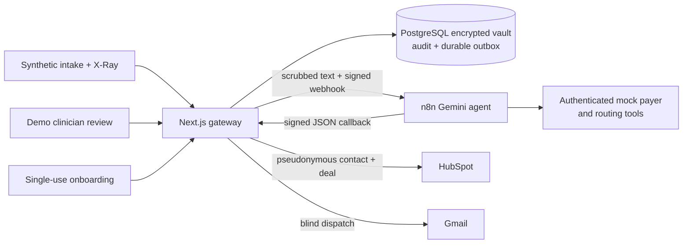

# AegisFlow

A portfolio demonstration of a privacy-focused patient intake workflow: encrypted intake → Gemini tool-calling agent → clinician review → single-use onboarding → HubSpot pipeline updates.

**Use synthetic data only.** This is an engineering demonstration, not a clinical service or a HIPAA-certified system. The insurance tool, clinician identity, consent forms, and appointment inventory are demonstrations. An LLM routing result is not a diagnosis or clinical validation.

## What works

- **Real Gemini agent in n8n.** The agent calls two authenticated HTTP tools for synthetic payer eligibility and routing rules, then produces schema-validated JSON. The verified configuration uses `models/gemini-3.1-flash-lite`.
- **Durable PostgreSQL lifecycle.** Intake, encrypted consent, audit entries, and the outbox commit together. Leased deliveries retry network failures and reconcile missing callbacks after two minutes. State survives an app restart.
- **Real HubSpot integration.** Contacts and deals use pseudonymous aliases and a unique patient UUID property. Retries upsert the same records; approval and completed booking advance a dedicated pipeline.
- **Gmail blind dispatch.** n8n sends only a patient UUID to the application. The application retrieves the address and invitation from the vault. Public demo mode defaults to an on-screen invitation, with no email sent. No Resend account is needed.
- **Clinician review and token burn.** JWT-protected review records each decryption. Booking atomically consumes a 48-hour capability; concurrent and repeated submissions cannot book twice. A critical result blocks approval on the server.
- **Inspectable security boundaries.** Contextual entity removal plus six regex passes, AES-256-GCM encryption, HMAC signatures with timestamp validation, browser-scoped telemetry, and PostgreSQL audit immutability triggers.

The X-Ray UI labels live execution, simulation, CRM progress, and email status. Simulation requires explicit demo flags; a real integration failure never creates a fake CRM ID.

The responsive interface shares a visual system across intake, clinician review, and patient onboarding. A four-stage journey rail keeps the flow visible; expandable evidence panels keep technical details available. See the [design notes](docs/DESIGN.md).

## Architecture



Raw intake identity and symptom fields are encrypted before database storage. n8n and Gemini receive scrubbed symptoms, a payer label, and pseudonymous metadata. The notification provider receives the recipient address and capability link. Scrubbing reduces identifier exposure but cannot guarantee de-identification of arbitrary free text. n8n execution saving is disabled; that setting alone does not establish a provider retention policy or regulatory compliance.

Open the [interactive architecture field guide](docs/architecture-explorer.html) in a browser to learn the system: clickable components, four request walkthroughs, data boundaries, database/API explanations, a code-reading path, portfolio assessment, and a short quiz. It is a self-contained offline HTML snapshot reviewed on 17 October 2026; Docker is not needed to read it. A separate [supporting source graph](graphify-out/graph.html) and [architecture report](graphify-out/GRAPH_REPORT.md) provide deeper references.

## Run locally

Requires Node.js 22.15+ and Docker Desktop.

```sh
npm ci
npm run env:init
docker compose up -d
npm run db:migrate
npm run dev -- --port 3005
```

Open [the application](http://localhost:3005). PostgreSQL uses port **5434**. The fresh-install commands above create an isolated n8n instance on **5679**. This machine uses the existing [n8n instance on port 5678](http://localhost:5678), with the same four AegisFlow workflow IDs updated in place. Follow the [existing-instance setup](docs/OPERATIONS.md#use-an-existing-n8n-instance-on-port-5678) to use that configuration. The database is required.

For live integrations:

1. Open the selected n8n instance: [5678 for this machine](http://localhost:5678), or [5679 for a fresh isolated install](http://localhost:5679). Complete owner setup if needed and add your Gemini API credential. Set its ID/name in `.env` as `N8N_GEMINI_CREDENTIAL_ID` and `N8N_GEMINI_CREDENTIAL_NAME`.
2. Set the HubSpot private app token. Required scopes: `crm.objects.contacts.read/write`, `crm.objects.deals.read/write`, and `crm.schemas.deals.read/write`. Run `npm run crm:setup` to create the unique deal property and pipeline stages. It writes the resulting IDs into `.env`.
3. Run `npm run workflows:generate`. Import the four JSON files in `n8n/workflows`, select the Gemini credential, and publish the three webhook workflows. See the [runbook](docs/OPERATIONS.md) for CLI import and validation.
4. Restart the app after changing environment variables. Submit the Routine preset and wait for `LIVE_GEMINI_N8N` and `CRM_SYNCED` in the inspector.

Leave `GMAIL_TEST_RECIPIENT` blank for the public portfolio demo. To test actual email, configure the Gmail OAuth values and explicitly set a controlled test inbox; all demo email redirects there. Do not commit `.env` or decrypted credential exports.

For an offline demonstration, explicitly set `AEGIS_CRM_MODE=simulated` and `DEMO_SIMULATE_N8N_IF_SLEEPING=true`, then restart the app. The inspector identifies the simulated execution. The default configuration attempts live integrations.

## Verification

```sh
npm test                 # crypto, scrubber, JWT, exported-workflow HMAC
npm run test:integration # separate aegis_test PostgreSQL database
npm run build            # type check + standalone production bundle
npx playwright install chromium
npm run test:e2e         # requires running live app, n8n, Gemini, HubSpot
npm run eval:gemini      # four illustrative synthetic AI cases
```

The browser suite runs the complete approval/booking flow and checks emergency blocking, unauthorized access, and capability replay. It creates synthetic HubSpot contacts/deals. Screenshots and walkthrough videos are written to ignored `test-results/`. The separate Gmail self-test requires explicit authorization and is excluded from automated browser tests.

See [verification evidence](docs/VERIFICATION.md) and the [AI evaluation record](docs/agent-evaluation.json). Four passing examples demonstrate wiring and routing behavior, not medical accuracy or robust prompt-injection resistance.

To try the running demo yourself, follow the [manual test walkthrough](docs/MANUAL_TESTING.md), including the expected results for a completed booking and an emergency case.

## Portfolio value

This project demonstrates asynchronous workflow orchestration, actual tool-calling AI, transactional state, external API idempotency, security boundaries, failure recovery, and browser verification. The strongest interview walkthrough is the ordinary lifecycle followed by one emergency case and a rejected token replay. Explain the boundaries and tradeoffs as well as the successful path.

Before any real patient use, it needs an appropriate identity provider and staff RBAC, clinical validation, provider agreements and retention review, infrastructure and key management, abuse controls, monitoring, backups, and operational security review. Public demo clinician access deliberately exposes synthetic records to demo users.

## Deployment and documentation

The [Docker deployment runbook](docs/OPERATIONS.md) covers the standalone image, migrations, environment configuration, worker recovery, and demo walkthrough. Hosting publication requires a chosen platform and public HTTPS hostname.

- [Specification](PRD.md), [implementation plan](IMPLEMENTATION_PLAN.md), [domain glossary](GLOSSARY.md)
- [Architecture decisions](docs/adr), [live progress board](PROGRESS.md)
